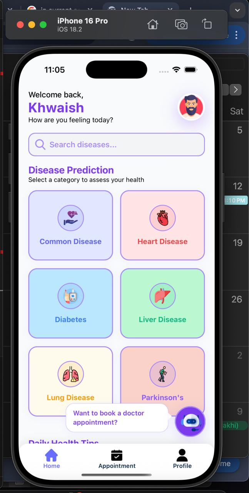
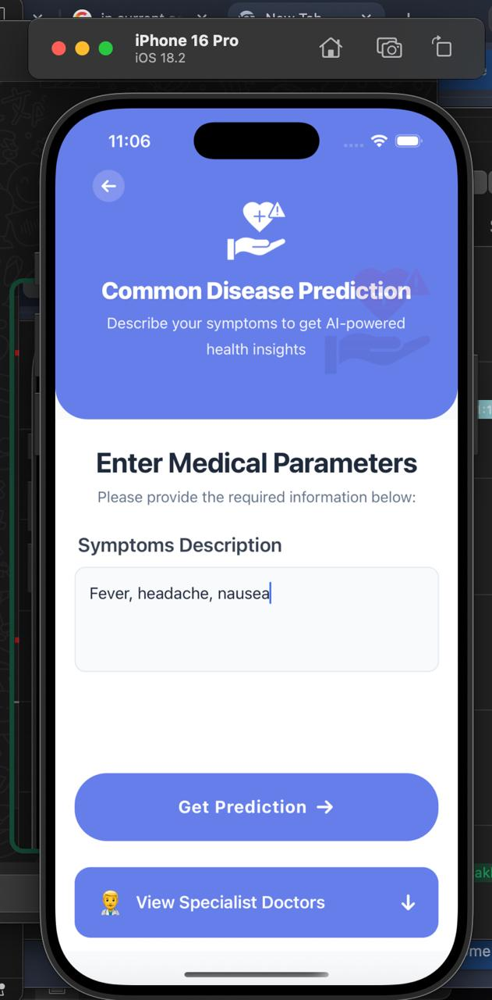
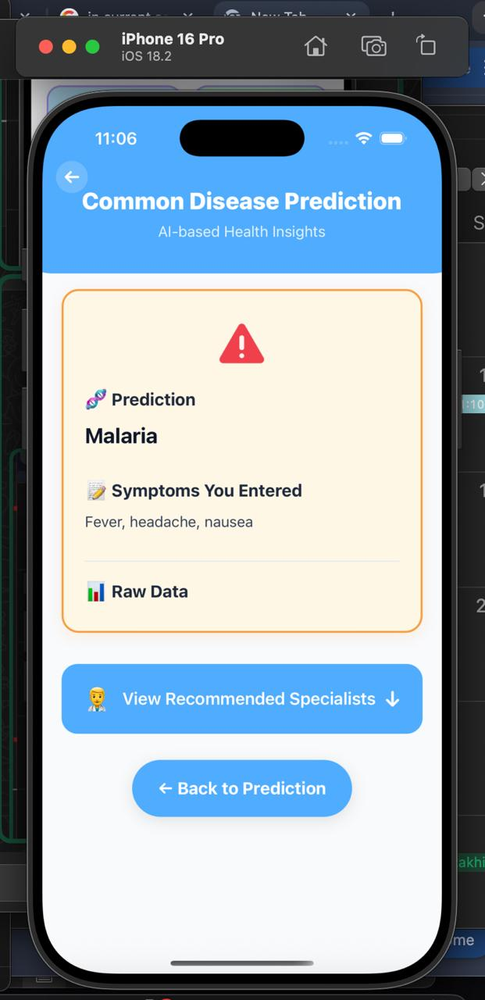
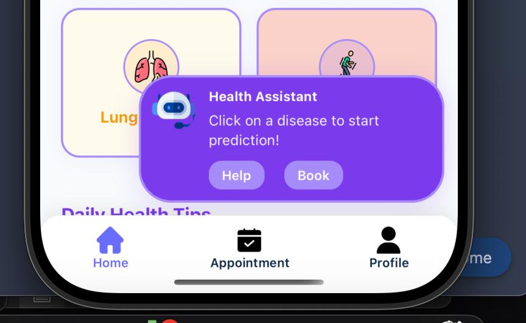
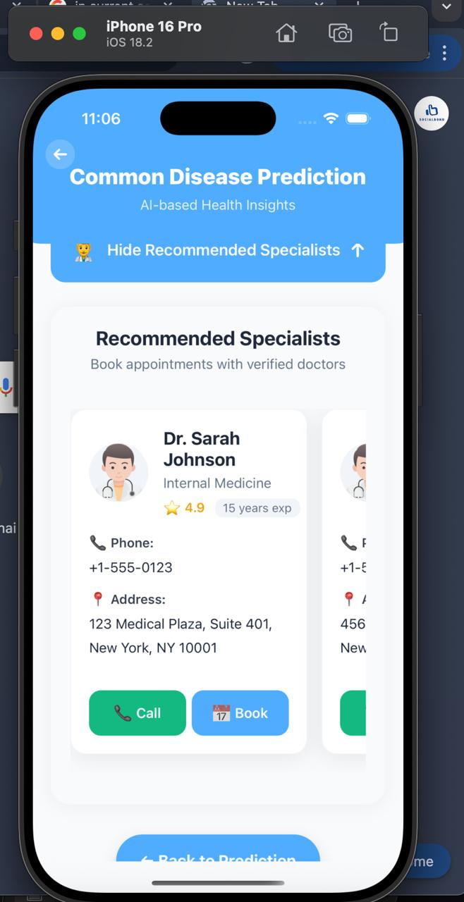
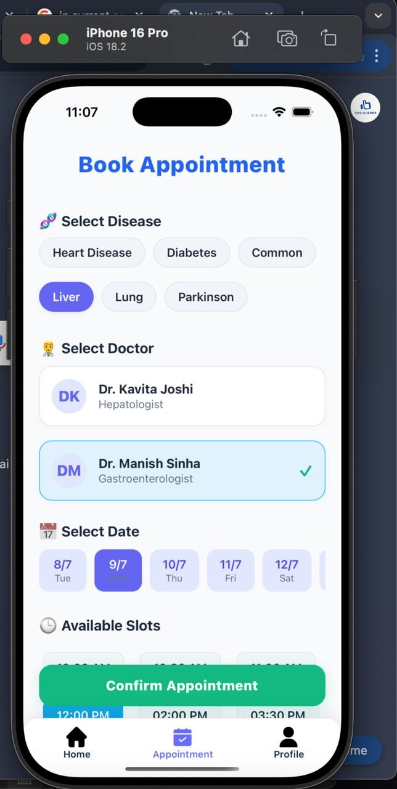
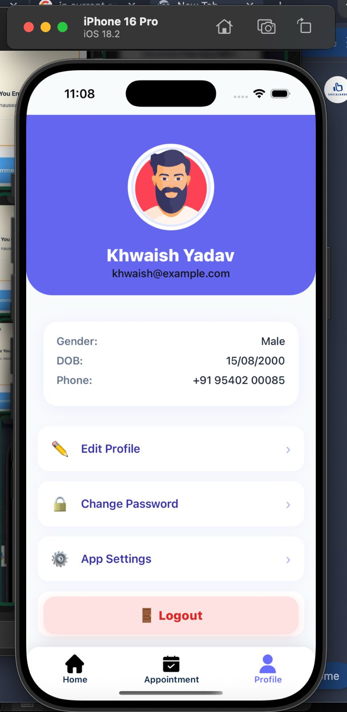

# 🧠 MediGuide — AI-Powered Personal Health Companion

MediGuide is a **team-developed healthcare application** that integrates machine learning-based disease prediction, symptom analysis, a medical chatbot, and doctor appointment features into a single mobile platform. The project aims to make preliminary health assessment more accessible through an intuitive mobile interface.

> **Project Type:** Team Project  
> **My Role:** Machine Learning (ML)  
> **Focus:** Data preprocessing, model development, training, and evaluation for disease prediction.


---

## 📽️ Demo Video

Watch the MediGuide application demo:

[▶️ **Watch the Demo Video on Google Drive**](https://drive.google.com/file/d/1W4khkqilvQFg58eGDDLM0P9rhx5bZ7k5/view?usp=drivesdk)

---

## ✨ Key Features

### 🩺 Machine Learning-Based Disease Prediction
- Supports disease prediction workflows for conditions including:
  - Heart disease
  - Diabetes
  - Liver disease
  - Lung cancer
  - Parkinson's disease
- Includes symptom-based common disease prediction.
- Uses trained machine learning models to process relevant input features and generate predictions.

### 🤖 Medical Chatbot
- Provides a conversational interface for health-related questions and symptom discussions.
- Helps users explore preliminary health information.

### 📅 Doctor and Appointment Features
- Includes doctor-related screens and appointment workflows.
- Connects the health assessment experience with doctor-related functionality.

### 📱 Mobile Application
- Built with React Native and TypeScript.
- Includes home, prediction, result, doctor, appointment, and profile screens.
- Communicates with a backend API.

---

## 👨‍💻 My Contribution — Machine Learning

MediGuide was developed collaboratively as a team project. **My primary responsibility was the machine learning component**, rather than claiming ownership of the entire mobile application or backend.

My ML work focused on the disease-prediction pipeline, including the following areas as applicable to the individual models:

- **Data preparation:** Working with disease datasets and preparing features for model development.
- **Data preprocessing:** Handling data quality issues and transforming input features into a suitable format for training.
- **Model development:** Working with machine learning models for supported disease-prediction tasks.
- **Training and evaluation:** Developing and evaluating models to assess their predictive performance.
- **Model integration support:** Preparing trained model artifacts for use by the application's prediction workflows.

The repository also contains disease-specific Jupyter notebooks, including `diabetes.ipynb`, `heart-disease-100.ipynb`, `liver.ipynb`, `lung-cancer-prediction.ipynb`, `parkinson.ipynb`, and `common-diseases.ipynb`.

These notebooks provide the basis for exploring the individual ML workflows.

### Team Collaboration

The project brings together the machine learning component, backend API, and mobile frontend. My contribution was focused on ML, while the overall application was built collaboratively with the team.

---

## 🛠️ Technology Stack

| Component | Technologies |
|---|---|
| Mobile frontend | React Native, TypeScript, JavaScript |
| Backend | Python, Flask |
| Machine learning | Python, disease-specific ML models |
| Data and experimentation | Jupyter Notebook, CSV datasets |
| Mobile platforms | Android and iOS project structure |
| API communication | Frontend-to-backend API integration |

---

## 📱 App Screenshots

The following screenshots show key screens from the MediGuide mobile application.

### 🏠 Home Screen


### 🩺 Disease Prediction


### 📊 Prediction Result


### 🤖 Medical Chatbot


### 👨‍⚕️ Doctors


### 📅 Appointment


### 👤 User Profile


---

## 📂 Project Structure

```text
MediGuide/
├── App.tsx
├── app.json
├── package.json
├── assets/                  # App images and visual assets
├── screens/                 # Mobile application screens
├── navigation/              # App navigation
├── core/                    # Shared app code and API integration
├── backend/
│   ├── app.py               # Flask backend entry point
│   ├── model/               # Model artifacts and datasets
│   ├── templates/            # HTML templates
│   └── static/              # Static files
├── screenshot/              # Application screenshots
├── common-diseases.ipynb     # Common disease prediction notebook
├── diabetes.ipynb            # Diabetes ML notebook
├── heart-disease-100.ipynb    # Heart disease ML notebook
├── liver.ipynb                # Liver disease ML notebook
├── lung-cancer-prediction.ipynb
└── parkinson.ipynb             # Parkinson's ML notebook
```

---

## 🚀 Getting Started

### Prerequisites

Install the following before running the project:

- Node.js and npm
- Python 3
- Android Studio and an Android emulator, or a connected Android device
- Required Python and JavaScript dependencies

### 1. Clone the Repository

```bash
git clone https://github.com/sparshpatidar2005/MediGuide.git
cd MediGuide
```

### 2. Install Frontend Dependencies

From the project root:

```bash
npm install
```

### 3. Set Up the Python Backend

```bash
cd backend
python -m venv venv
```

Activate the environment on Windows:

```powershell
.\venv\Scripts\Activate.ps1
```

On macOS or Linux:

```bash
source venv/bin/activate
```

Install backend dependencies using the project's requirements file, if available:

```bash
pip install -r requirements.txt
```

Then start the backend:

```bash
python app.py
```

**Note:** Verify the backend dependency file and required model artifacts are present before running the backend. The actual model binaries must be available for the corresponding prediction endpoints to work.

### 4. Run the Mobile Application

Open a separate terminal in the project root.

For Android:

```bash
npx react-native run-android
```

For iOS on macOS:

```bash
npx pod-install ios
npx react-native run-ios
```

Ensure the backend URL in the frontend configuration is appropriate for your device or emulator.

---

## ⚠️ Project Disclaimer

MediGuide is an educational software project intended to demonstrate machine learning and healthcare application integration. Its predictions and chatbot responses are not a substitute for professional medical diagnosis, treatment, or advice.

---

## 🤝 Acknowledgements

Developed collaboratively as a team project, combining machine learning, backend services, and mobile application development.

